<!-- Assets in assets/ are generated by scripts/build_assets.py (light + dark). -->

<a href="https://portfolio-webapp-roan.vercel.app">
  <picture>
    <source media="(prefers-color-scheme: dark)" srcset="assets/hero-dark.svg">
    
  </picture>
</a>

  
  
  

  <a href="#projects"><b>Projects</b></a> ·
  <a href="#security"><b>Security</b></a> ·
  <a href="#simulators"><b>Simulators</b></a> ·
  <a href="#stack"><b>Stack</b></a> ·
  <a href="#proof-of-work"><b>Proof of work</b></a> ·
  <a href="#runnable"><b>Runnable today</b></a>

I’m **Naresh**, a **distributed systems and GPU networking engineer**. I work on the infrastructure that large-scale training and inference run on: kernel networking, RDMA/RoCE, DPDK, SR-IOV, KVM and NCCL. When a 512-GPU job stalls, the cause is usually one bad link, NIC or GPU, while every rank reports the same timeout. I build the infrastructure that finds that one component and gets training back fast, and that moves bytes between GPUs without wasting the hardware.

I also design it to be **secure by construction**. The fastest paths in an AI cluster are the least watched: RDMA bypasses the host kernel, and AI agents now hold the credentials that reach it.

**What I'd own on your team**

- **Make failures attributable.** Turn "all 512 ranks timed out" into "rank 3, `mlx5_2`, bad optic", then take the cheapest recovery that is still safe.
- **Keep the fabric fast under pressure.** RoCE congestion control (PFC, ECN, DCQCN), rail-optimized topologies, KV-cache transport for disaggregated inference.
- **Close the blind spots.** Kernel-bypass traffic, agent credentials, and the checkpoint and model supply chain.

Everything here is **built in public**. A number only appears once it’s measured and linked to its run.

## 🎯 Two problems I work on

<table>
<tr>
<td width="50%" valign="top">

### 🔵 Reliability at scale
**[goodput](https://github.com/nareshns2004/fault-tolerant-training-orchestrator)**: fault attribution & recovery for multi-node training

**Problem.** One bad GPU, NIC, cable or switch port stalls a collective, and *every* rank times out the same way. Stock tooling detects in minutes, attributes nothing, and restarts the whole job.

**Approach.** Fault injection with a ground-truth ledger, NCCL flight-recorder signatures, DCGM and NIC telemetry joined on the topology to name the **culprit rank and component**, then the smallest safe recovery: in-process communicator re-init, single-node replacement, peer in-memory checkpoints.

**Status.** `M1 of 6` · design, interfaces and harness public · no results yet

**Downstream.** goodput's labeled incidents will train two Hugging Face models that plug back in as its classifier: a calibrated, evidence-citing ModernBERT triage tier and a grounded Qwen3 + LoRA root-cause tier ([see below](#hugging-face)). `planned`

</td>
<td width="50%" valign="top">

### 🟠 Efficiency at scale
**[kvwire](https://github.com/nareshns2004/disaggregated-inference-engine)**: RDMA KV-cache transport for disaggregated inference

**Problem.** Prefill is compute-bound and decode is memory-bound. Colocated, they interfere: prefills spike TPOT, decodes spike TTFT.

**Approach.** Split them onto separate GPU pools, and make the part in between fast and safe: a GPUDirect RDMA transport, a Triton KV re-layout kernel (kept only if the data justifies it), and a coordinator that stays correct when the network fails mid-transfer. Plugs into vLLM through its KV-connector interface.

**Status.** `M1` · baselines and hardware ceilings first

</td>
</tr>
</table>

<picture>
  <source media="(prefers-color-scheme: dark)" srcset="assets/systems-dark.svg">
  
</picture>

## ⏱️ One timeout, many causes

In NCCL, nearly every hardware fault ends the same way: a watchdog timeout on every rank. The engineering is in the last two columns: naming the one component, then choosing the cheapest recovery that is still safe.

| Fault | What every rank reports | Evidence that names the component | Smallest safe recovery |
|---|---|---|---|
| GPU off the bus (Xid 79) | Watchdog timeout, same collective sequence number | Xid in kernel log / DCGM; the one rank missing from the flight recorder's last completed op | Swap in a spare node, restore from peer in-memory checkpoint |
| Uncorrectable ECC / row-remap failure (Xid 48, 64) | Hang or NaN loss, then timeout | DCGM ECC and row-remap counters on one GPU | Drain node, resume from last checkpoint |
| NVLink fault (Xid 74) | Intra-node collectives stall | Xid 74, NVLink CRC / replay counters | Swap node |
| RoCE link flap or bad optic | Inter-node all-reduce stalls on all ranks | `link_downed`, symbol / CRC errors on one NIC port, IB async events | Communicator re-init once the link recovers; else swap node |
| PFC pause storm | All ranks slow, **no errors anywhere** | Pause counters traced hop by hop to the port that paused first (FIG. 3 below) | Fix the origin (ECN / DCQCN thresholds, isolate port); restarting changes nothing |
| Straggler (thermal / power throttling) | Step-time skew, no timeout | DCGM clock-throttle reasons, per-rank step time | Cordon at the next checkpoint boundary |

## 🛡️ The fast path is the blind path

An AI agent with a kubeconfig is a remote shell that takes instructions from whatever it reads. One injected sentence in a log line, ticket or web page is enough. No exploit is needed, because **the agent's permissions are the blast radius**. Underneath it, the GPU fabric is where host security sees least: RDMA and GPUDirect bypass the kernel, so host firewalls, eBPF and host IDS never see that traffic, and NCCL has no built-in encryption or peer authentication. In a cluster where model weights are the crown jewels, I treat security as a property of the infrastructure, not a layer added afterwards.

<picture>
  <source media="(prefers-color-scheme: dark)" srcset="assets/security-dark.svg">
  
</picture>

| Layer | What goes wrong | Why AI makes it worse | Control I design for |
|---|---|---|---|
| Agents & tools | Prompt injection steers an agent that can run `kubectl`, `sbatch` or cloud APIs | The agent reads untrusted text all day and acts at machine speed | Read-only tools by default. Mutations go through an allowlisted, audited executor; destructive actions need a human |
| Identity | Long-lived tokens, shared service accounts, ambient admin | One leaked token reaches every node, bucket and checkpoint | Workload identity, short-lived per-task credentials, deny by default |
| Fabric (RDMA / RoCE / NCCL) | Kernel bypass hides traffic from host controls. Collectives cross the fabric in plaintext. A leaked `rkey` grants remote memory access | Gradients, activations and KV cache are the model, in transit | Per-tenant isolation (IB partition keys, VRF per tenant), scoped and revocable memory windows, inline MACsec/IPsec on NICs that offload it, telemetry at the NIC/DPU because the host can't see it |
| Multi-tenant inference | Shared prefix caches leak prompts through timing. GPU memory outlives the job | Serving is multi-tenant by default | Per-tenant cache isolation, scrub on reassignment, MIG or confidential computing (Hopper/Blackwell CC mode) where the threat model needs it |
| Artifacts | Pickled checkpoints run code on load. Unsigned weights and datasets | One tampered checkpoint is restored onto every replica | `safetensors` / `weights_only=True`, signed and hashed checkpoints, dataset provenance |
| My own tooling | goodput's RCA model is itself an agent touching production | Same risk as above, on the infrastructure itself | It **recommends, never acts**: it sees read-only evidence, and recovery runs only through goodput's allowlisted executor `planned` |

## 🤗 On Hugging Face: learning that table from ground truth

goodput's fault injector knows exactly what it broke, so every incident it produces is labeled by construction. Those incidents become a public benchmark and two models that plug back into goodput as its classifier, and have to beat its hand-written rules to earn the slot. Models live on **[huggingface.co/nareshns2004](https://huggingface.co/nareshns2004)**.

| Artifact | What it does | Stage |
|---|---|---|
| `infra-failure-bench` · dataset | Multi-host incident windows with root cause, culprit and evidence lines. Test splits hold out cluster topologies, cascades (root ≠ loudest symptom) and real incidents | design · awaiting goodput export |
| `infra-triage-modernbert` | Fast tier: root-cause class, the lines that prove it, calibrated resolve-or-escalate; milliseconds on CPU via ONNX | design |
| [`qwen3-nccl-rca-lora`](https://huggingface.co/nareshns2004/qwen3-nccl-rca-lora) | Slow tier: grounded RCA naming culprit, causal chain and cited lines; GRPO on rewards a script can check (citations exist, category and culprit match the ledger) | model card (no weights yet) |

## 🧪 Simulators & capacity models

Each one runs in the browser, with its model and assumptions stated. No hand-waved benchmarks.

| | Model | What it shows |
|---|---|---|
| 💥 | [**One dead link, 512 idle GPUs**](https://portfolio-webapp-roan.vercel.app/posts/ring-allreduce-failure.html) | Cut a link in a live ring all-reduce and watch every rank time out the same way |
| 🔎 | [**Triaging an NCCL timeout**](https://portfolio-webapp-roan.vercel.app/posts/nccl-timeout-triage.html) | Four incident drills: find the culprit from flight-recorder, Xid and NIC evidence |
| 🧊 | [**PFC: the lossless network that can freeze itself**](https://portfolio-webapp-roan.vercel.app/posts/pfc-deadlock.html) | Push a toy RoCE fabric into deadlock, then turn on ECN |
| 🛤️ | [**Where NCCL traffic actually goes**](https://portfolio-webapp-roan.vercel.app/posts/rail-topology.html) | Rail-optimized vs fat-tree for DP, TP and MoE all-to-all, with and without PXN |
| 📦 | [**The KV-cache bill**](https://portfolio-webapp-roan.vercel.app/posts/kv-cache-transfer.html) | Size the prefill→decode handoff for real model configs and link speeds |
| 💾 | [**How often should a 16K-GPU job checkpoint?**](https://portfolio-webapp-roan.vercel.app/posts/checkpoint-interval.html) | Young/Daly with sliders: which lever buys the most goodput |
| 🧵 | [**The packet path**](https://portfolio-webapp-roan.vercel.app/posts/packet-path.html) | Step one packet through the kernel stack, XDP, DPDK and RDMA |

## 🧱 Where I work in the stack

<picture>
  <source media="(prefers-color-scheme: dark)" srcset="assets/layers-dark.svg">
  
</picture>

### 🔗 Proof of work, by area

No self-ratings: every row links to the work and states how far along it is.

| Area | Evidence | Stage |
|---|---|---|
| Collectives & NCCL | [goodput](https://github.com/nareshns2004/fault-tolerant-training-orchestrator) · [distributed-training-framework-nccl](https://github.com/nareshns2004/distributed-training-framework-nccl) · [ring all-reduce post](https://portfolio-webapp-roan.vercel.app/posts/ring-allreduce-failure.html) | design + harness |
| RDMA / RoCE / PFC | [nicprof](https://github.com/nareshns2004/ai-nic-performance-profiler) · [kvwire](https://github.com/nareshns2004/disaggregated-inference-engine) · [PFC post](https://portfolio-webapp-roan.vercel.app/posts/pfc-deadlock.html) | runnable |
| Linux kernel performance | [kptk](https://github.com/nareshns2004/kernel-performance-toolkit) | runnable |
| Inference serving | [kvwire](https://github.com/nareshns2004/disaggregated-inference-engine) · [high-performance-llm-inference-engine](https://github.com/nareshns2004/high-performance-llm-inference-engine) · [KV-cache post](https://portfolio-webapp-roan.vercel.app/posts/kv-cache-transfer.html) | early |
| GPU kernels (CUDA / Triton) | [custom-cuda-fused-attention-triton](https://github.com/nareshns2004/custom-cuda-fused-attention-triton) | early |
| eBPF / XDP / DPDK | [kernel-level-ai-traffic-shaper](https://github.com/nareshns2004/kernel-level-ai-traffic-shaper) · [packet path post](https://portfolio-webapp-roan.vercel.app/posts/packet-path.html) | early / write-up |
| Secure AI infrastructure | [threat model and controls](#security) · goodput's read-only RCA tier and allowlisted recovery executor | design |
| Incident triage models | [qwen3-nccl-rca-lora](https://huggingface.co/nareshns2004/qwen3-nccl-rca-lora) (grounded NCCL root-cause analysis, verifiable rewards) | model card (no weights yet) |

## 🛠️ Runnable today

- **[nicprof](https://github.com/nareshns2004/ai-nic-performance-profiler)**: which NIC counter explains which millisecond of training step time. Aligns RDMA/ethtool/SR-IOV counters to each rank’s steps and traces PFC pause back to its origin, so a *victim* port isn’t blamed. `nicprof demo` · 69 tests
- **[kptk](https://github.com/nareshns2004/kernel-performance-toolkit)**: explains *why* a Linux workload is slow from kernel evidence: run-queue delay, NUMA locality, THP fallback, and `perf_event_open(2)` called directly. Standard library only · 43 tests

<picture>
  <source media="(prefers-color-scheme: dark)" srcset="assets/pfc-dark.svg">
  
</picture>

 

   
  USA · Canada · Europe · reach me through <a href="https://portfolio-webapp-roan.vercel.app">the portfolio</a>

